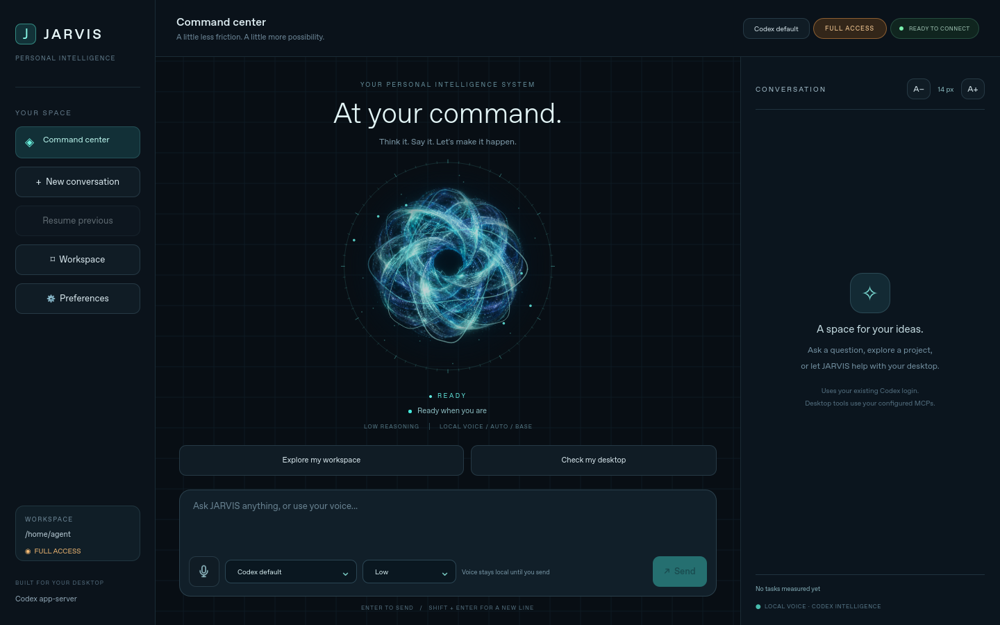
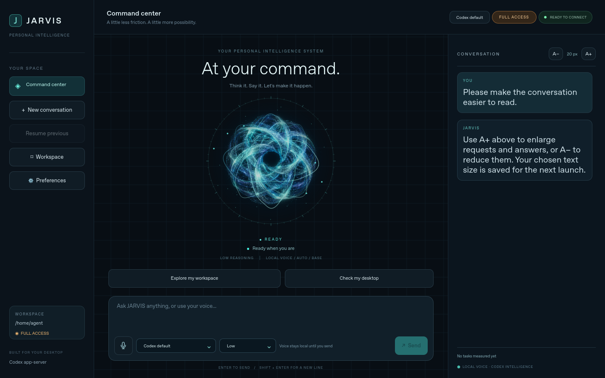
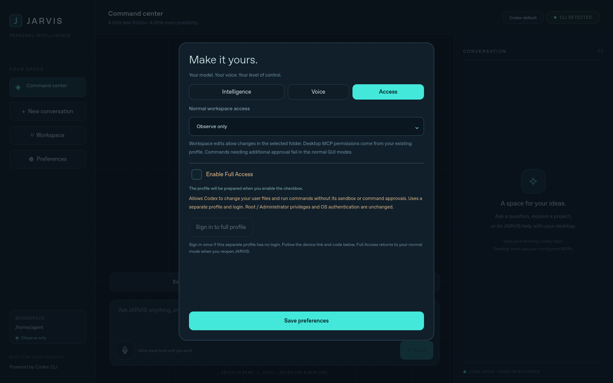
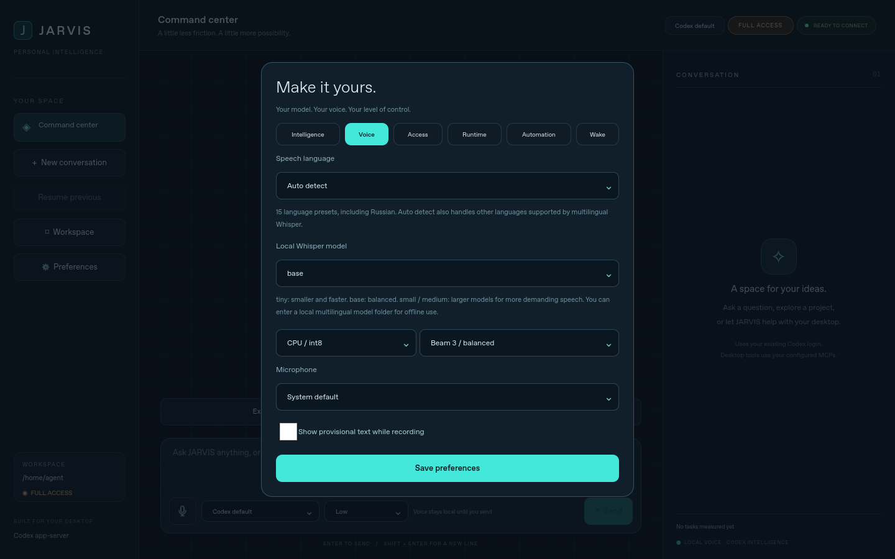

# JARVIS desktop application

A native Qt Quick window for Linux and Windows 11, with an animated cyan core,
a streaming conversation panel, model/workspace selection, reasoning presets and
warm local push-to-talk voice input. Runtime and Automation tabs expose task
timings, scoped conversation resume and checked desktop workflows. The same interface runs on both platforms; platform-specific
launchers and menu installers are provided. This is a source distribution,
not a signed standalone EXE, AppImage, DEB or RPM release.



## Conversation text size

Use **A- / A+** beside **CONVERSATION** at the top of the right-hand panel to
change message text from 12 to 28 pixels in two-pixel steps. The default is 14
pixels. The change applies immediately to existing and incoming requests,
responses and status messages, and is saved for the next launch. It works while
an answer streams and preserves the conversation, connection and unsent draft.



## Animated activity core

The central J has been replaced with an original woven-light energy sculpture.
Its bundled still artwork was generated for this project; Qt Canvas draws the
moving filaments, particles, trails and state effects locally. It works with the
software renderer and requires no new dependency or network request.


| Activity | Visual behavior |
|---|---|
| Ready | Slow turquoise breathing and drifting filaments |
| Connecting, voice preparation, profile setup | Pale-blue rotating preparation arc |
| Recording | Mint filaments expand and the center wave responds to microphone level |
| Transcribing | Blue processing wave and traveling arc |
| Planning | Violet orbital loops change inclination |
| Acting | Faster blue particles with short orbital trails |
| Verifying | Amber sweep across the core |
| Complete | Three settling green waves followed by a calm halo |
| Failed | Pink separated arcs and a slow attention pulse |
| Stopping / stopped | Muted arcs; stopped motion freezes |

Colors transition gently and every state also has a text label. The waveform is
an amplitude visualization, not an audio oscilloscope. The verification sweep
indicates the runtime stage, not an additional screen capture. The animation
targets 20 updates/second in standby and about 30 while active, and pauses when
the window is minimized. Core size adapts to window height to keep the composer
and Send button visible at the supported minimum size.

The preview cycles simulated runtime/audio states in the actual QML window.
It demonstrates rendering rather than real microphone or desktop automation.

For a fresh installation, use the [complete commands for your operating system](install-desktop.md).
They cover Arch/CachyOS, Debian/Ubuntu/Mint, Fedora, openSUSE and Windows 11.

## Prerequisites

- Install Git, [uv](https://docs.astral.sh/uv/getting-started/installation/)
  and [Codex CLI](https://github.com/openai/codex).
- Run `codex login` in your normal terminal before sending requests.
- Python 3.11 through 3.14 is supported. uv can provision a compatible Python.
- For actual desktop operations, set up the normal JARVIS desktop MCP using
  the existing [Linux](linux.md) or [Windows](windows11.md) instructions.
  The frontend uses existing Codex authentication, instructions and MCP entries;
  it does not register or change them.

## Linux

From the repository root:

```bash
bash scripts/jarvis-gui-linux.sh
```

The first launch installs the locked Qt and voice dependencies in `gui/.venv`.
For a launcher in your application menu and a `~/.local/bin/jarvis-gui` command:

```bash
bash scripts/install-gui-linux.sh
```

Keep the checkout at its current path: the menu entry points to it. Re-run the
installer if you move it. It installs current-user launchers, menu entries and
the shared Codex desktop configuration. Unmanaged launchers/menu entries with the same
names are refused. Remove the two generated GUI launcher/menu files
to uninstall the menu entry; existing CLI JARVIS configuration is unaffected.

The GUI installer updates the ordinary JARVIS backend and launchers in your
current Codex profile. Existing sign-in and MCP settings are reused. Full Access
is on by default; disable it in Preferences > Access for a saved sandbox mode.

Qt requires a graphical X11 or Wayland session and its native platform libraries.
Install missing runtime libraries using your distribution's package manager.
Typical Debian/Ubuntu packages are `libegl1`, `libopengl0`, `libxcb-cursor0`,
`libxkbcommon-x11-0` and `libportaudio2`. Fedora commonly uses `mesa-libEGL`,
`libxcb`, `xcb-util-cursor`, `libxkbcommon-x11` and `portaudio`; Arch uses
`mesa`, `libxcb`, `xcb-util-cursor`, `libxkbcommon-x11` and `portaudio`.
Package names vary by release. If a Wayland session fails to select its Qt
platform plugin, try `QT_QPA_PLATFORM=wayland bash scripts/jarvis-gui-linux.sh`;
use `xcb` only when an X display is available.

The UI is designed for Linux distributions supported by Qt, rather than tied
to one desktop compositor. Actual GUI automation still depends on the configured
MCP's capabilities. Every distribution/compositor combination has not been tested.

## Windows 11

Open a normal PowerShell window at the repository root:

```powershell
powershell.exe -NoProfile -ExecutionPolicy Bypass -File .\scripts\jarvis-gui-windows.ps1
```

For a Start menu shortcut that opens the window without a console:

```powershell
powershell.exe -NoProfile -ExecutionPolicy Bypass -File .\scripts\install-gui-windows.ps1
```

The shortcut uses the project's virtual-environment `pythonw.exe`. Keep the
checkout in place. Remove `JARVIS.lnk` from your current-user Start menu to remove
the shortcut. No Administrator session or global execution-policy changes are
required. The npm `codex.cmd` installation is launched through its Node entry
point, avoiding shell interpolation of paths or requests.

The Windows GUI installer calls the ordinary installer in a child PowerShell
without changing `CODEX_HOME`. It handles a missing `windows-mcp` registration
without letting expected native stderr abort PowerShell 5. Run from a normal,
non-elevated PowerShell. See [installation commands](install-desktop.md#windows-11).

## Use the app

1. Choose **Workspace**. This is the working directory for Codex requests.
2. Type a request and press **Send** or Enter. Shift+Enter inserts a new line.
3. Replies appear in the conversation panel. Command/MCP activity appears below
   the animated core. Follow-up requests resume the current Codex thread.
4. **Stop** or Escape cancels the active task. Completed actions are not undone.
5. **New conversation** or Ctrl+N starts a fresh context. Changing the workspace
   or access mode also resets the context.

Preferences has **Intelligence**, **Voice**, **Access**, **Runtime**,
**Automation** and **Wake** tabs. Intelligence
offers a live `model/list` picker when app-server is connected, the active
profile's local `models_cache.json` before connection, an editable model ID, and
a Refresh button. No credentials are read from that file.
The cache can be empty or stale: run Codex once and refresh, or enter an ID from
your provider. Availability is validated by the actual request, not by the cache.
An empty selection / **Codex default** inherits the configured model. Changing
the model starts a fresh conversation. The selected ID is supplied as structured
app-server thread/turn parameters.

Preferences offer Fast (`low`), Normal (existing Codex default) and Deep (`high`)
reasoning. Choose Normal if your configured model does not support low reasoning.
Workspace access defaults to **Full Access**. Disable it in the Access tab to use
**Observe only** (`read-only`) or workspace edits. **Allow workspace
edits** explicitly selects `workspace-write` for the chosen folder. This frontend
uses an owned persistent `codex app-server --listen stdio://` connection;
additional approvals are declined under `approvalPolicy="never"`. Use the regular
interactive CLI for tasks needing those approvals. No exec fallback or OpenCode
backend is used in the GUI.

## Full Access from the GUI

Full Access is enabled by default. **Preferences > Access > Enable Full Access**
can turn it off or on without an installer or a separate login. Turning it off
selects the retained read-only/workspace-edit sandbox. Your choice survives
restart and is shared with regular `jarvis` CLI launchers.

All modes use the current `CODEX_HOME` (default `~/.codex`), existing Codex login,
model catalog, Skills and MCP configuration. **Sign in to Codex** is only needed
when that account is not already authenticated. No authentication files are copied.
Changing access closes the owned app-server and resets conversation context;
the next connection uses the same home with the chosen sandbox. Access-scoped
checkpoints cannot resume an unrestricted thread in a restricted mode.

Full Access sets `danger-full-access` and `approvalPolicy=never`. It can change
user-accessible files and execute commands without Codex command approvals.
It does not elevate the OS account or bypass native/backend authentication.
Existing MCP confinement/input settings are retained independently of the shell
sandbox. Launch JARVIS as a normal user, not root/Administrator.



## Composer model and reasoning controls

The bottom left of the input box has an editable Codex model picker and a
reasoning picker. They apply immediately and keep the unsent draft. Model changes
start a fresh conversation; reasoning changes keep the conversation. Controls
are disabled while a task/voice/sign-in is active. Live model metadata limits
reasoning choices to supported values; before connection the standard choices
are model default, low, medium, high and extra high. Availability still depends
on the selected model/provider. Custom model IDs are accepted on Enter.
The same controls remain in Preferences > Intelligence.

## Voice input

For optional continuous local listening that opens this window by name, see
[voice activation](voice-activation.md). Enable it in **Preferences > Wake**;
push-to-talk below remains the normal way to dictate a task.

Click the microphone button, speak, then click it again. Recording stops after
60 seconds at most. The ring responds to the microphone level. Local
faster-whisper defaults to CPU int8 with the multilingual `base` model;
Russian and other languages are detected automatically. The first voice use
loads/downloads the model; subsequent recordings reuse it for five idle minutes. Internet access to the Hugging Face model/CDN
hosts is needed for that download; a configured local model directory can be
supplied through `JARVIS_VOICE_MODEL` for offline use. Audio is held in memory
and is not saved or uploaded by the voice worker.

The transcript is placed in the composer and **never submitted automatically**.
Review/edit it, then press Send to submit its text to Codex. Cancel is available
during microphone startup, recording, downloading and transcription. Request
microphone permission in Windows Privacy settings or your Linux desktop when
necessary. Before the first launch, `JARVIS_VOICE_LANGUAGE` (for example `ru`)
and `JARVIS_VOICE_MODEL` seed these preferences. Later changes can be made in
the Voice tab and are retained in user settings.

For text-only use, without the voice packages:

```bash
bash scripts/jarvis-gui-linux.sh --no-voice
```

```powershell
.\scripts\jarvis-gui-windows.ps1 -NoVoice
```

## Development and validation

```bash
uv sync --project gui --frozen --extra voice
python3 -m unittest discover -s tests -v
uv run --project gui --frozen python -m unittest discover -s gui/tests -v
```

Headless Linux smoke test (does not send a Codex request or access a microphone):

```bash
QT_QPA_PLATFORM=offscreen QT_QUICK_BACKEND=software \
  uv run --project gui --frozen jarvis-gui --smoke-test --screenshot /tmp/jarvis.png
```

`gui/uv.lock` pins the dependencies. An isolated QML test exercises the real
composer and conversation panel against a fake CLI process, including compact
layout rendering. Process tests cover stdin prompts, resume, fragmented JSON,
failures, cancellation and transcript review. Audio/model tests use simulated
devices and transcription; they do not establish hardware-level microphone or
model accuracy. A Qt process/window CI job runs on Ubuntu and Windows runners.

Local validation has covered the Linux offscreen UI and simulated integrations.
Live Windows desktop behavior, microphone capture/transcription, authenticated
model requests and compositor-specific GUI actions require checks on the target
machine. Do not interpret simulated test results as those checks.

The app stores workspace, model, reasoning, normal access and voice preferences in user settings.
Conversation text stays in app memory; Codex maintains its own session history
under its existing configuration. GUI settings retain bounded, profile/workspace/
model-scoped thread pointers and status for explicit resume, without copying
conversation text. Quitting the app stops its workers, including idle processes.
With voice activation enabled, the window close button keeps the app listening
in the tray/minimized; use Quit or disable voice activation to stop it.
`JARVIS_GUI_CODEX` can point to an alternative Codex executable for development;
it is a path, not a shell command.

## Local speech languages and models

In **Preferences > Voice**, choose Auto detect or one of 15 explicit languages:
Russian, English, Ukrainian, German, French, Spanish, Italian, Portuguese,
Polish, Turkish, Arabic, Chinese, Japanese, Korean and Hindi. Russian uses the
Whisper `ru` language code; this preserves the original speech language rather
than translating it into English. Auto detect also supports other languages
covered by multilingual Whisper. Accuracy varies by language, audio and model.

The model picker offers `tiny`, `base`, `small`, and `medium`. Larger models use
more memory and computation. Other official multilingual Whisper sizes or a
local converted model folder can be entered manually. English-only `.en` model
names are not accepted. The saved model is supplied when the persistent worker starts; language is
supplied per recording. Existing `JARVIS_VOICE_*` variables seed the initial
preferences. CPU/CUDA, beam size, microphone and optional provisional-text
controls are described in [the runtime guide](runtime.md). Recordings remain capped at 60 seconds and are never submitted
automatically.



The settings window now uses dark controls and tabs. The main screen shows the
selected Codex model, reasoning, voice language/model and active access level.
The core animation is limited to about 30 frames per second and pauses when
minimized. No model or transcription latency benchmark is claimed.

## Persistent runtime and new controls

The owned Codex app-server stays connected between messages. Whisper stays
loaded between explicit recordings, then unloads after five idle minutes.
Replies stream into incremental chat rows. **Preferences > Runtime** displays
connection/MCP status and task/voice timings and exports content-free JSON.
**Resume previous** restores a conversation scoped to workspace, profile, access
and model without replaying actions. **Preferences > Automation** stores exact
aliases for checked desktop MCP sequences. The optional reasoning heuristic is
in Intelligence; voice device/beam/preview options are in Voice.

Read [runtime.md](runtime.md) for local commands, workflow JSON examples,
permissions, cancellation, timing semantics and validation limits, and
[related-projects.md](related-projects.md) for the checked external references.
General task replay, Doctor auto-repair, editor API bridges, wake words and
spoken TTS answers remain future work.
