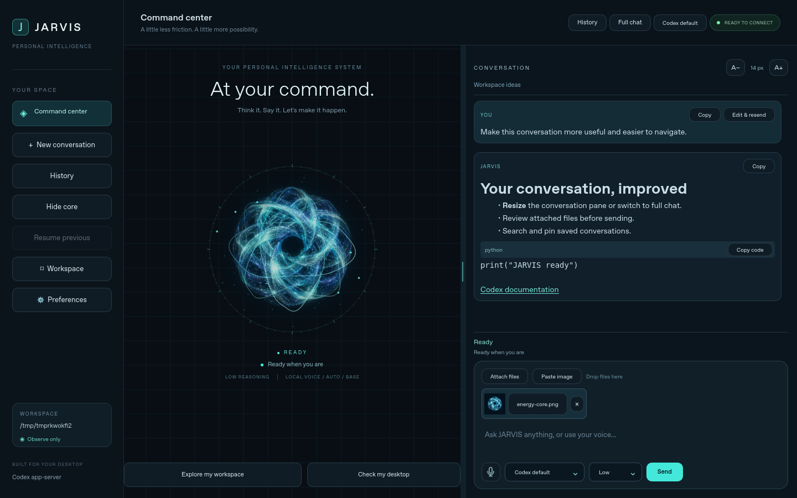
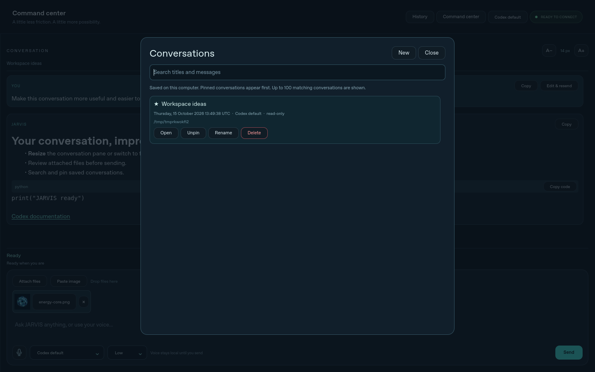

# Conversation controls and local history

GUI 0.5.0 adds these controls on Linux and Windows 11. Codex app-server remains
the only model transport; Claude Code and direct API backends are deferred.

## Layout and reading

Drag the vertical divider between the core and conversation to change their
widths. **Hide core / Show core** removes or restores the artwork pane.
**Full chat / Command center** also hides or restores the sidebar, leaving the
conversation and its composer across the window. Width and layout choices are
saved. The composer stays below the conversation in every layout; model,
reasoning, voice, attachments and Send remain together.

Use **A- / A+** for 12–28 px message text. Replies render Markdown headings,
lists, emphasis, tables and web links; fenced code gets a language label and
**Copy code**. Raw HTML and inline images are inert; message rendering does not
fetch external images. HTTP(S) links open only when clicked. User requests and
file previews remain plain text. Scroll up to read earlier messages without
streaming pulling you down; **Latest** restores following the answer.

## Message actions

**Copy** copies the original message text. **Edit & resend** places a user
request and its still-available attachments in the composer for review. Press
Send to submit it as a new turn in the current conversation. Earlier messages
and completed actions remain; editing is not a rollback or automatic retry.
Missing or changed attachments are reported for reattachment.

## Files, images and screenshots

Use **Attach files**, drag local files onto the window, or copy a screenshot
and choose **Paste image**. Nothing is submitted until Send. Click a chip to
preview an image or the first 8 KB of a UTF-8 file; the cross removes it.

- Up to 10 regular local files per request, 20 MB each.
- PNG, JPEG, WebP, GIF and BMP previews, up to 20 megapixels.
- Images use the app-server `localImage` input. Other files use an explicit text reference with
  their name and absolute path. They are file references, not a generic cloud
  file-upload API; Codex needs applicable tools, format support and permissions
  to read them. Selecting a PDF or other binary is not proof of extraction.
- A changed size/modification time blocks Send until the file is reattached.
  A rejected request preserves its draft and selected files.
- Clipboard screenshots are private local PNG copies. Selected originals remain
  in place; history stores references rather than snapshots of those originals.

## History and privacy

**History** searches titles and message contents, including Russian text. Pin
important conversations, rename their automatic titles, open them, or delete a
local entry after confirmation. The list shows the 100 newest matching entries,
with pinned entries first; this is a display limit, not automatic deletion.

Conversations are saved in a local SQLite database:

- Linux: `~/.local/share/jarvis-codex/conversations.sqlite3`.
- Windows: `%LOCALAPPDATA%\jarvis-codex\conversations.sqlite3`.

The database stores conversation text, attachment metadata/previews, title,
workspace/model/access, and the Codex thread pointer. Clipboard image copies
live beside it under `attachments/`. Original selected files are never deleted.
Unused owned clipboard images are cleaned when removed or their last local
conversation is deleted, provided saved references can be checked. No history
or file is uploaded to this repository. Local history is not the separate
user-confirmed repair memory or the content-free timings export. It is local
storage, not an encrypted vault; do not commit the database or cached images.

Opening history immediately displays saved text without executing a request.
The next Send resumes its Codex thread, without replaying old prompts/actions.
It uses the saved workspace/model and requires the current access mode to match;
opening never widens access. Entries are scoped to the current Codex home.
A missing workspace/thread is reported. A transcript with no saved thread says
that its next request starts a new Codex session. Each saved transcript is
limited to 8 MB; errors are shown without discarding the active conversation.

## Work status and shortcuts

The card above the composer shows connection/thinking/tool/checking/answer state,
elapsed request time and the current activity. Failures expose their reason;
Stop remains available during requests, voice work and sign-in. Elapsed time is
not a completion percentage or a guaranteed remaining-time estimate.

| Shortcut | Action |
|---|---|
| Ctrl+N | New conversation when idle |
| Ctrl+H | History |
| Ctrl+Shift+F | Toggle full chat |
| Ctrl+O | Attach files |
| Ctrl+Shift+V | Paste a clipboard image |
| Enter / Shift+Enter | Send / new line |
| Escape | Stop active work or close a popup |

Validation uses fixture conversations, files and app-server processes. It does
not establish authenticated image/model behavior, real system clipboard or
compositor permissions on every user machine.
