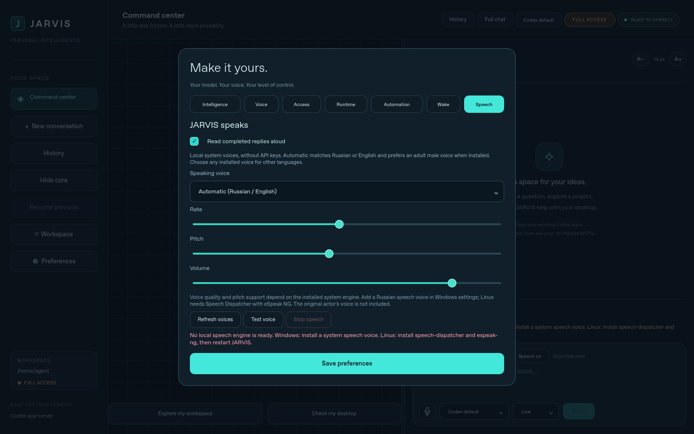

# JARVIS character and local spoken replies

Updating the ordinary GUI installer refreshes `jarvis-desktop/SKILL.md` and the
managed block of your Codex `AGENTS.md`, preserving personal instructions.
Start a new conversation to load updated instructions. The character is calm,
attentive and respectful: the user is the mentor and decision-maker. JARVIS
uses the user's language, concise explanations and occasional dry wit, accepts
corrections and can disagree thoughtfully. This is a conversational style,
without claiming fictional identity, consciousness or additional permissions.

## Controls

- **Speech on/off** in the composer saves automatic reading; it is on by default.
- **Read** on an assistant message reads it even with automatic speech off.
- **Stop speech** interrupts output. Escape also stops speech when no task or
  recording has priority. Sending a new task or starting recording stops output.
- **Preferences > Speech** selects an installed voice and saves rate, pitch and
  volume. Use **Refresh voices**, **Test voice**, then Save to keep slider changes.
  Test applies the displayed voice settings. The automatic checkbox applies
  immediately. Native engines differ in pitch/rate support and voice quality.

Automatic reads only the current successful completed final answer. Streamed
fragments, commentary, failed/canceled turns and restored conversations stay
silent. Code fences, images, formatting and raw web URLs are removed from the
spoken copy; the displayed answer remains unchanged. Speech is bounded to
6,000 characters including a notice to read the remainder in chat. This is not
semantic summarization. Automatic language choice supports Russian/English,
preferring an adult male voice when installed. Other languages work by choosing
an installed voice explicitly. A missing matching voice is reported instead of
using the wrong language. This does not include an actor's cloned voice.



## Windows 11

Qt uses a local Windows `winrt` or `sapi` engine. Open **Settings > Time &
language > Speech > Add voices**, install Russian, restart JARVIS and Refresh
voices. Select a voice exposed in JARVIS's list: Narrator-only voices may not
be exposed by the native Qt engine. Check Windows audio output and volume if
the test is silent. Voice installation may require an initial system download;
speaking through installed local voices does not require a TTS API key.

## Linux

Install Speech Dispatcher, its speech output module and eSpeak NG. For CachyOS
and Arch derivatives:

```bash
sudo pacman -S --needed speech-dispatcher espeak-ng
```

Debian/Ubuntu:

```bash
sudo apt install speech-dispatcher espeak-ng libspeechd2
```

Fedora:

```bash
sudo dnf install speech-dispatcher speech-dispatcher-espeak-ng espeak-ng
```

On openSUSE, use the Speech Dispatcher/eSpeak NG packages and output module
provided by your release. Check the distribution's module configuration if
Russian is absent from the voice list. Restart JARVIS after installing packages.
If provided, `spd-say -l ru "Speech test"` checks the system output independently.
The GUI installer never invokes sudo or edits system speech configuration.
Qt uses `speechd`, or `flite` if its plugin and suitable voices are installed.
No test/mock engine is selected as a production fallback.

## Microphone, privacy and troubleshooting

Speech uses local system synthesis, without a cloud TTS request or audio-file
storage. People nearby can hear spoken answers; use Speech off or headphones
when appropriate. Model requests still use Codex as before.

Before playback, the optional wake worker must acknowledge that capture is
paused (or exit if stalled). It remains paused until speech finishes plus a
300 ms cooldown. Push-to-talk interrupts speech, waits for quiet, then starts
capture; canceling that request discards late callbacks. The warm transcription
worker can remain loaded. This is coordinated turn-taking, not full-duplex
conversation or echo cancellation; delayed room echoes can still be heard.

Missing voices, native engine errors and failure to start within five seconds
are visible in chat/settings; a failure does not resend the model request.
Refresh voices after fixing system configuration. Speech stops on app shutdown
and has a ten-minute bound. A missing engine leaves chat and voice input usable.
The automated tests use deterministic adapters and Qt's injected test plugin;
actual voice quality, speakers and microphone behavior require a target-machine
test on Linux/Windows.
