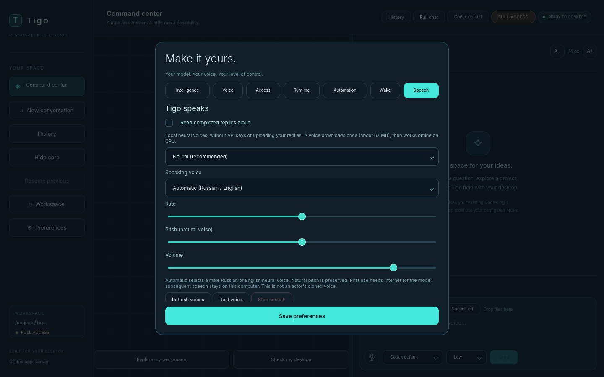
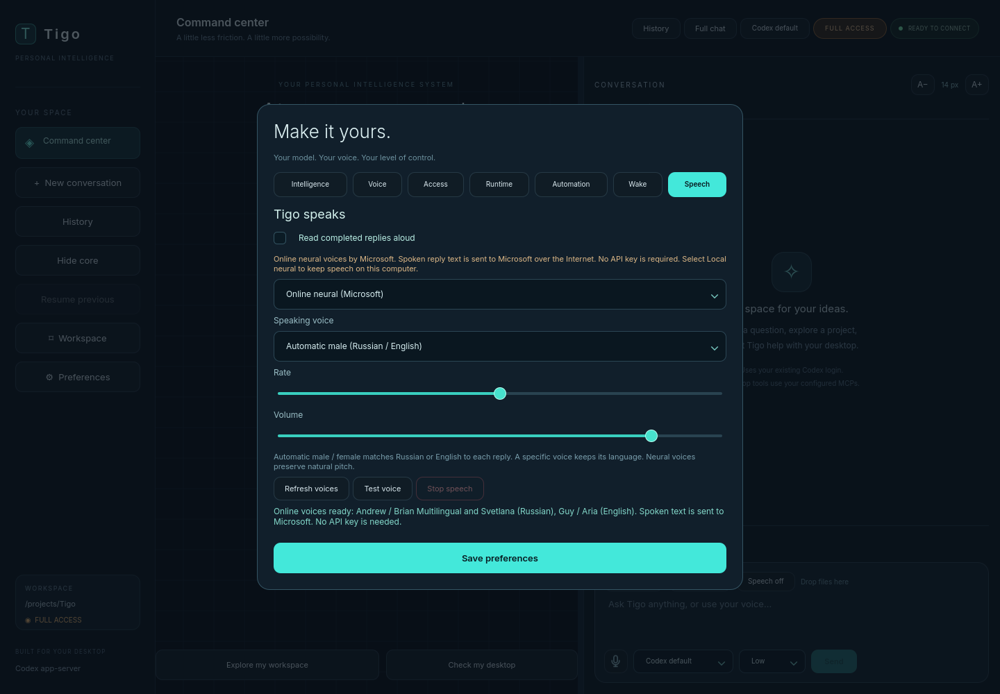

# Tigo voices: local and online (0.9.0)

Preferences > Speech offers trained **male and female** voices. Local neural
speech remains the default; online output is an explicit choice. Existing
Speech off, rate, volume and selected local voice survive the update.

## Voice catalog

| Mode | Russian male | Russian female | English male | English female |
| --- | --- | --- | --- | --- |
| Local neural | Dmitri; optional Denis | Irina | Joe | Lessac High |
| Online Microsoft | Andrew Multilingual; optional Brian Multilingual | Svetlana | Guy | Aria |

Choose **Automatic male** or **Automatic female** to match Russian/English to
an answer, or select a specific voice. A specific voice uses its selected
language for the whole answer. Mixed-language pronunciation depends on the
trained model. Natural pitch is preserved; rate and volume remain adjustable.
The speaking copy pronounces the product name as its Russian spelling in
Russian prose, while displayed chat text remains unchanged. No actor clone,
custom emotion classifier or full-duplex conversation is implied.



## Local neural: offline after download

Piper/VITS runs on CPU through sherpa-onnx. Male models and Irina download about
67 MB each; Lessac High is about 116 MB. Downloads verify pinned size/SHA-256,
bound extraction and retain model cards. At most two models stay warm. All
synthesis and playback happen outside the GUI thread, with transient PCM in RAM.
No speech text is uploaded in local mode and no runtime audio file is saved.

Fresh caches use `${XDG_CACHE_HOME:-~/.cache}/tigo/voices` on Linux or
`%LOCALAPPDATA%\tigo\voices` on Windows. Existing pre-rename caches are reused.
Full updaters preload the default male Russian/English pair; other voices load
on first use. To prepare female voices without playing audio:

```bash
uv run --project gui --frozen --extra voice python -m tigo_gui.speech_models ru_RU-irina-medium en_US-lessac-high
```

Ordinary launchers install the frozen voice dependencies. Linux needs PortAudio;
Windows uses the sounddevice wheel runtime. No GPU, Torch, API key, Russian
Windows language pack or elevated TTS installation is needed.

## Online neural: Microsoft

Select **Online neural (Microsoft)** to use the online Edge speech service
through the [edge-tts client](https://github.com/rany2/edge-tts). It requires
Internet and sends the **cleaned spoken reply text to Microsoft**. Reading an
old message in online mode sends that message's spoken copy too. The microphone,
recordings and code blocks are not sent by the TTS worker. No separate API key
is required. This is an unofficial client of the Edge service, not an Azure
subscription with a service-level guarantee.

Catalog browsing and changing modes do not submit an utterance. Automatic
speech starts for assistant prose as complete sentences arrive, when enabled;
**Read** and **Test voice** are explicit requests. Local failures never select
online mode. Online errors do not change providers or replay audio. A network
failure leaves text chat usable and explains selecting local output.

The worker fetches bounded phrases, decodes MP3 to mono 24 kHz PCM with PyAV,
prefetches at most a small bounded number of phrases and plays from RAM. Each
request has a 35-second bound; encoded size and decoded duration are bounded.
Stop kills the owned worker and pending requests immediately. Nothing is
written to an audio cache. This service's availability and voice catalog can
change independently of Tigo. In live development probes the listed native
Dmitry voice returned no audio; the offered multilingual male alternatives,
Svetlana, Guy and Aria returned decodable audio instead.



## Controls and microphone coordination

- **Speech on/off** saves automatic reading; **Read** still works with auto off.
- **Preferences > Speech** selects mode, male/female voice, rate and volume.
  Voice choices are saved separately for each mode. Pitch applies only to the
  explicit **System voices (legacy)** mode.
- **Test voice** applies the displayed voice/sliders and speaks a fixed sample
  in the selected voice's language. Automatic uses the configured input language
  (Russian unless explicitly English). Save preferences keeps the choice.
- **Stop speech**, recording, a new request and shutdown interrupt output.
  Escape stops speech when another task/recording does not have priority.
- Wake capture must acknowledge pause or exit before playback. It stays paused
  through speech and a 300 ms quiet tail. Recording waits for the owned speech
  process to exit; stale callbacks cannot restart canceled speech or recording.

Assistant prose, including commentary, is automatically queued as sentences arrive. See [live voice](live-voice.md) for ordered playback, cancellation and limits.
Already spoken progress cannot be recalled on task failure/cancellation; pending
speech is stopped. Opened history stays silent. Fenced code,
images, raw URLs and markup are removed from the speaking copy, bounded to
6,000 characters. A ten-minute overall limit applies. System mode still supports
installed OS voices for other languages; neural output defaults to Russian or
English. See [voice notices](voice-notices.md) and [changes.md](../changes.md)
for provenance and actual verification limits.
