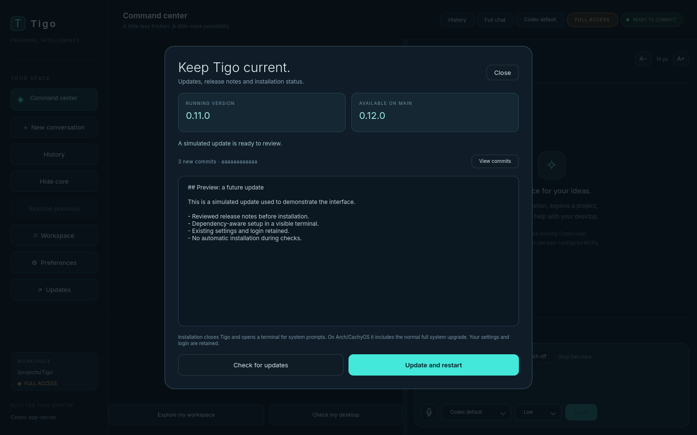

# Update Center and one-step setup

Open **Updates** in the sidebar, or press **Ctrl+U**. The center shows the running
version, the version on the official `main` branch, new commit count, recent
change reports, a compare link and the last installer result. Notes are plain
text; remote Markdown/HTML is never executed by the UI.



## Check and install

**Check for updates** runs in an owned worker. It validates the checkout root,
official origin, clean working tree and `main`, then fetches remote Git objects.
It does not checkout/merge files or install dependencies. Ahead and diverged
histories are distinguished; local edits, unexpected origins, detached/other
branches and failures stop the operation without reset, stash or deletion.
Checking is on demand, with bounded subprocess time/output and cancellation.

**Update and restart** becomes available for a fast-forward update while Tigo
is idle, with no unsent draft or attachments. The worker checks the selected
commit again and copies its platform bootstrap to private application storage.
The running version's stdlib-only launcher is copied outside the checkout/venv.
Tigo opens an ordinary terminal and waits for its readiness handshake before
approving shutdown. If no supported terminal opens, the GUI stays open.

The runner waits for Tigo to exit before replacing files/dependencies. It then
executes the bootstrap pinned to the reviewed revision. A changed remote head
requires another check. Native `sudo`, winget/UAC and Codex device-login prompts
remain in the terminal. Arch/CachyOS includes the normal full `pacman -Syu`
upgrade. No elevated GUI, hidden password entry or ownership-guard bypass is used.

On success a new launch is requested. Only a small UTC result record is stored
for the next center; terminal output, authentication codes and credentials are
not copied to an update log. Failures remain visible in the terminal. Source may
already have fast-forwarded when a later dependency step fails: rerun the setup
script after resolving that error. No automatic rollback or destructive Git
recovery is performed. Existing user settings, history, caches and login stay
in their usual locations.

## One-step install or update

The common entry points are [install.sh](../install.sh),
[install.ps1](../install.ps1) and [install.cmd](../install.cmd). They always fetch
the current official bootstrap; GUI updates instead use a reviewed Git revision.
These URLs become available when the files are published to `main`.

**Windows 11:** close Tigo with **Quit Tigo**. In ordinary PowerShell, without
Administrator mode, paste this single command:

```powershell
irm https://raw.githubusercontent.com/ggnomer123s/Codex-jarvis/main/install.ps1 | iex
```

This downloads and executes the official setup entry point in the current
PowerShell session. Alternatively, run `install.cmd` from a downloaded checkout,
or run the saved script:

```powershell
powershell.exe -NoProfile -ExecutionPolicy Bypass -File .\install.ps1 -RepoPath 'D:\Apps\Tigo'
```

**Supported Linux families:** close Tigo and run from an ordinary user terminal:

```bash
bash -c 'set -euo pipefail; curl --proto "=https" --tlsv1.2 -fsSL https://raw.githubusercontent.com/ggnomer123s/Codex-jarvis/main/install.sh | bash'
```

Requires Bash, curl, sudo, x86-64 and glibc 2.34+. If curl is absent, install it
with the distribution package manager first. Supported setup paths cover
Arch/CachyOS derivatives, Debian/Ubuntu/Mint, Fedora and openSUSE. macOS, ARM and
Alpine/musl need separate packaging work. Package availability differs by
distribution release; these paths are not evidence of hardware testing on each OS.

A downloaded script also accepts a custom checkout path:

```bash
bash install.sh "$HOME/Documents/Tigo"
```

The default path is `~/Tigo` on Linux or `%USERPROFILE%\Tigo` on Windows. The GUI
always updates its actual source checkout, including a differently named folder.

## Dependencies and GUI motion

No new pip dependencies were added for the center or animations. Linux setup
installs the Qt/audio/desktop packages listed in the
[OS installation guide](install-desktop.md). GTK4 layer-shell availability remains
compositor/distribution-specific. A new Debian-family path installs the typelib
only where available; openSUSE reports its optional overlay prerequisites.

The universal non-Arch Linux setup uses a compatible existing Node 22+ and npm.
Otherwise it downloads an official Node 22 x64 archive, verifies its SHA-256
against the official HTTPS manifest and installs it only under
`$XDG_DATA_HOME/tigo/runtime/node` (default `~/.local/share/tigo/runtime/node`).
The GUI launcher includes this private runtime in PATH. Existing system Node and
unmanaged user executable links are not replaced. See
[Node release archives](https://nodejs.org/dist/latest-v22.x/SHASUMS256.txt).
uv's [official installer](https://docs.astral.sh/uv/getting-started/installation/)
is used when uv/uvx are missing; frozen application extras and the existing
Codex login are retained.

Minimal GUI transitions include button press/hover/focus, popup fades with a
small scale transition, preference-tab fading, new-message fade-in and three
activity dots. They animate item properties without repainting the static grid
or large artwork. **Preferences > Runtime > Reduce interface motion** persists
the preference, freezes core motion and disables these transitions. New message
fades do not restart on every streamed text update. Notifications have a Dismiss
button, and the sidebar compresses its spacing at smaller supported heights.

## Maintainer contract

Keep entry points, platform bootstrap scripts, GUI checker/runner and documented
commands compatible when dependencies, launch paths or setup requirements change.
Record every change in `changes.md`, including installation implications and the
checks actually run. This rule is also stored in [AGENTS.md](../AGENTS.md).

Validation uses local Git remotes, harmless fake installers, worker/terminal
handshakes and the production QML at minimum/default sizes. No fixture performs
real sudo, winget, authenticated model requests or a live application update.
