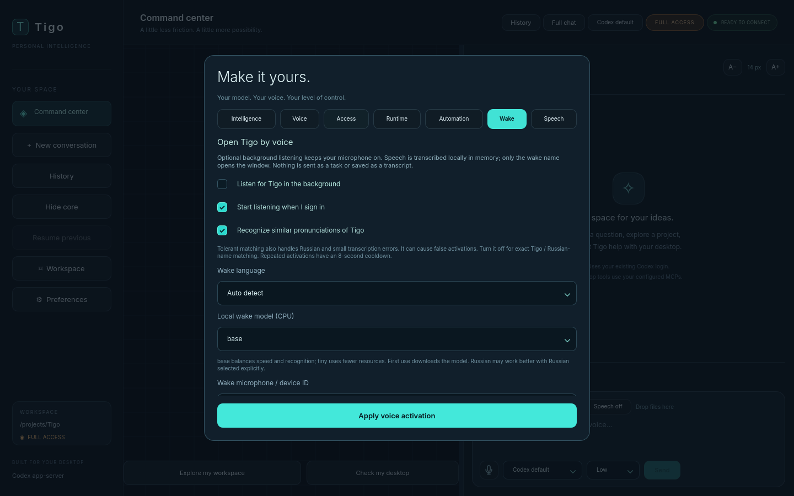

# Local voice activation

**Preferences > Wake** enables a background listener that opens the Tigo
window when local transcription contains `Tigo`, its Russian name or an
optional close spelling. It is off by default and uses existing faster-whisper
dependencies. Codex app-server remains the only GUI model backend.

## Enable it

1. Update the checkout and use the voice-enabled launcher:
   `bash scripts/tigo-gui-linux.sh` on Linux, or
   `powershell.exe -NoProfile -ExecutionPolicy Bypass -File .\scripts\tigo-gui-windows.ps1`
   on Windows 11. Linux also needs PortAudio; see the installation guide.
2. Open **Preferences > Wake**. Select **Russian** for mostly Russian speech,
   **English** for English, or **Auto detect** for mixed speech. Short names can
   be harder to identify in Auto mode.
3. Choose a multilingual model: `base` is the default, `tiny` uses fewer resources,
   and `small` may improve recognition at higher CPU/memory cost. A converted
   local model folder is accepted. Wake inference uses CPU int8 with at most
   four CPU threads; the manual voice worker's CUDA setting is independent.
4. Select a microphone or leave **System default**. To populate device choices,
   use **Prepare saved model / list microphones** in the Voice tab first. An
   input-device ID or name can also be entered directly.
5. Keep **Recognize similar pronunciations** enabled for tolerant matching, or
   disable it for exact English/Russian wake-name tokens. Keep **Start listening
   when I sign in** checked if desired.
6. Check **Listen for Tigo in the background**. This applies the displayed wake
   settings immediately. Later model/language/microphone changes require
   **Apply voice activation**. Wait for the microphone-on status; first use may
   download the selected model.



Say the wake name in a short phrase. The existing window is restored. The rest
of the sentence is not submitted as a task. Dictate a request with the existing
microphone button, review it, then Send. Other speech is discarded after the
local wake-name check.

## Background and sign-in

With voice activation enabled, closing the window leaves the listener running
with a tray icon. Its menu restores the window, disables voice activation or
quits. Without tray support, close and background login startup minimize the
window instead, keeping the app reachable. The sidebar displays listener status.

**Quit Tigo** in the tray menu or **Quit Tigo / stop listening** in the Wake
tab stops all app workers. A checked startup option still applies at the next
sign-in. Uncheck background listening to stop the microphone and remove Tigo's
own startup entry. A startup-cleanup error is reported without keeping the
microphone enabled.

Startup registration is per-user, without elevation:

- Linux: `$XDG_CONFIG_HOME/autostart/tigo-voice.desktop`, defaulting to
  `~/.config/autostart/tigo-voice.desktop`.
- Windows 11: `HKCU\Software\Microsoft\Windows\CurrentVersion\Run`, value
  `TigoVoiceActivation`, using the environment's `pythonw.exe`.

It launches the current environment's Python with `-m tigo_gui --background`.
Keep the checkout and environment in place; reapply Wake settings after moving
them. Unrelated startup files/values are not replaced. Linux requires a graphical
session honoring XDG autostart; minimal window managers may require their own
session-autostart support to be enabled.

For bare Hyprland sessions that do not consume XDG autostart, an optional
`exec-once` line in your own Hyprland configuration can launch the same saved
opt-in. Replace the path with your actual checkout; Tigo does not edit the
compositor configuration automatically:

```ini
exec-once = "/absolute/path/to/Tigo/gui/.venv/bin/python" -m tigo_gui --background
```

Manual background start after setup:

```bash
bash scripts/tigo-gui-linux.sh --background
```

```powershell
powershell.exe -NoProfile -ExecutionPolicy Bypass -File .\scripts\tigo-gui-windows.ps1 -Background
```

Without saved opt-in, `--background` exits without opening a microphone. A second
normal launch restores the existing instance through same-user local IPC; no
network listener is exposed. Wayland/Windows focus policies may highlight/show
the window rather than forcibly transferring keyboard focus.

## Spoken replies and microphone coordination

The local wake microphone pauses before Tigo speaks. Speech waits for the
worker's pause acknowledgment and resumes listening after a 300 ms audio-tail
cooldown. Manual push-to-talk interrupts output and waits for quiet before
recording. This prevents ordinary self-activation; it is not full-duplex echo
cancellation. External speakers or delayed room echoes can still warrant a
headset. See [spoken replies](speech-output.md).

## Audio and resource limits

While enabled, the background microphone stays open. Its callback only queues
PCM. Energy-based segmentation ends phrases after about 0.65 seconds of silence
or a four-second maximum, with short overlap at boundaries. Whisper VAD and
no-speech filters precede matching. This is local STT, not a dedicated low-power
wake-word model or instantaneous online recognition.

Only status/wake signals leave the worker. Ordinary transcripts are not logged,
displayed, saved in settings/history or sent to Codex; audio stays in bounded
RAM buffers. Model files are cached on disk and first download needs Internet;
an existing converted model directory supports offline use. Normal pauses keep
the wake model loaded. The separate manual worker may also retain its own model
for five idle minutes.

The listener closes its capture stream before manual voice input begins.
Pause/resume generations discard stale inference. If pausing stalls for 1.5
seconds, only the wake worker is killed before releasing the mic, then reloaded
after manual voice finishes.

An eight-second cooldown limits repeated activations. Tolerant matching accepts
explicit Tigo transcription variants and split-name tokens; it can cause
false activations. Exact mode accepts only whole English/Russian name tokens.
Neither guarantees recognition of every utterance. Select the actual language,
check the microphone and try `base`/`small` if names are missed. If CPU inference
falls behind, a bounded queue skips older phrases and reports it; try `tiny` or
reduce other CPU load.
This does not identify speakers: the wake name in media or another person's
speech near the microphone can also restore the window.

OS microphone permissions apply. This does not operate at the Windows lock/login
screen, submit tasks automatically, archive conversations or speak replies.
Automated tests use simulated audio/model output, real Qt processes, local IPC
and QML. Microphone accuracy, native login startup/tray and focus behavior still
require testing on the target desktop.
